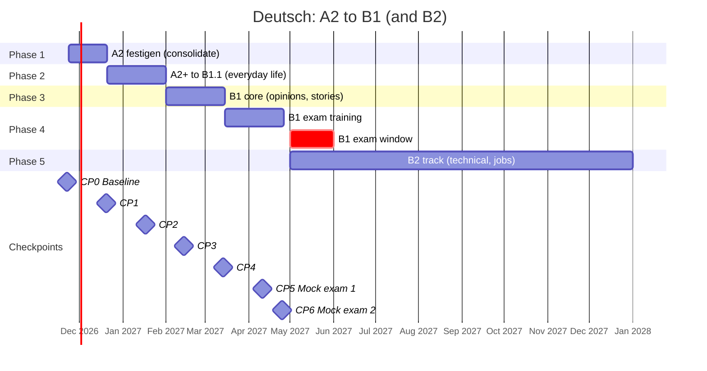

# The plan: A2 to B1 in 22 weeks, then B2

**Start:** Wednesday, 18 November 2026 (Session 00, setup)
**B1 speaking target:** end of April 2027
**B1 exam:** May 2027 (Goethe-Zertifikat B1 or telc Deutsch B1)
**B2 target:** December 2027

**Time budget:** 60 to 90 minutes per day (session 30 to 40 min, input 20 to 30 min, Anki 10 min, one real life moment). That is roughly 150 to 200 hours until the exam, which matches the usual effort from A2 to B1. Living in Darmstadt and speaking every day can make it faster. Skipped weeks make it slower.

## Timeline

## Milestones you should feel

| When | You can ... |
|---|---|
| End of Phase 1 (Dec 2026) | talk 3 minutes about yourself, your studies and Darmstadt without stopping, and handle shops, Mensa and appointments fully in German |
| End of Phase 2 (Jan 2027) | solve everyday problems in German (doctor, landlord, Deutsche Bahn, complaints) and tell stories about the past |
| End of Phase 3 (Mar 2027) | hold a 10 minute conversation on familiar topics, give and defend opinions, and explain your field simply |
| End of Phase 4 (Apr 2027) | pass a B1 mock exam in all four parts, especially speaking |
| End of Phase 5 (Dec 2027) | do a job interview, present a technical project and follow most uni conversations in German |

---

## Phase 1: A2 festigen (consolidate A2) · W1 to W4

Goal: make what you already know automatic. Speed and confidence before new grammar.

| ✓ | Week | Dates | Topic | Grammar spotlight | Real life mission |
|---|---|---|---|---|---|
| [ ] | W0 | Nov 18 to 22 | Setup and baseline | none, just talk | Install Anki and import the deck; install Tandem or HelloTalk; CP0 baseline |
| [ ] | W1 | Nov 23 to 29 | Ich und mein Leben in Darmstadt (studies, flat, routine) | V2 word order, Perfekt with haben/sein | Order only in German at the bakery and the Mensa, every day |
| [ ] | W2 | Nov 30 to Dec 6 | Alltag und Termine (doctor, Bürgeramt, phone) | Modal verbs, Dativ pronouns (mir, dir, Ihnen) | Make one appointment by phone in German |
| [ ] | W3 | Dec 7 to 13 | Uni und Arbeit (Sprechstunde, group work, emails to professors) | Nebensätze: weil, dass, wenn, ob | Write one real email in German |
| [ ] | W4 | Dec 14 to 20 | Freizeit und Weihnachtsmarkt (plans, invitations, small talk) | Präteritum: war, hatte, musste, konnte | Small talk with a stranger at the Weihnachtsmarkt. **CP1 on Sunday** |

## Phase 2: A2+ to B1.1 (everyday problems) · W5 to W10

Goal: survive and solve every everyday situation. Holidays in W5 and W6: lighter sessions are fine, but keep the streak.

| ✓ | Week | Dates | Topic | Grammar spotlight | Real life mission |
|---|---|---|---|---|---|
| [ ] | W5 | Dec 21 to 27 | Feiertage und Traditionen (Christmas, Turkey vs Germany) | Wechselpräpositionen (in, auf, an + Akk/Dat) | Watch one German Christmas film with German subtitles |
| [ ] | W6 | Dec 28 to Jan 3 | Reisen und Deutsche Bahn (tickets, delays, directions) | Reflexive verbs (sich freuen, sich beeilen) | Ask for directions or help at a station in German |
| [ ] | W7 | Jan 4 to 10 | Wohnung und WG (landlord, repairs, neighbours) | Konjunktiv II for politeness (würde, hätte, könnte) | Polite request in German (landlord, Hausmeister, neighbour) |
| [ ] | W8 | Jan 11 to 17 | Gesundheit (doctor, pharmacy, symptoms) | Adjective endings basics (after der/ein) | Pharmacy or doctor visit fully in German. **CP2 on Sunday** |
| [ ] | W9 | Jan 18 to 24 | Einkaufen und Reklamation (returns, complaints) | Comparative and superlative | Return or ask about a product in German |
| [ ] | W10 | Jan 25 to 31 | Behörden und Verträge (Ausländerbehörde, bank, phone contract) | Separable and inseparable verbs | Read one official letter alone, then explain it to Claude |

## Phase 3: B1 core (opinions, stories, your field) · W11 to W16

Goal: from "surviving" to "really talking". Longer answers, connectors, opinions.

| ✓ | Week | Dates | Topic | Grammar spotlight | Real life mission |
|---|---|---|---|---|---|
| [ ] | W11 | Feb 1 to 7 | Meinung sagen (agree, disagree, discuss) | Connectors: deshalb, trotzdem, obwohl | 30 minute Tandem call in German |
| [ ] | W12 | Feb 8 to 14 | Mein Fach (aerospace explained simply) | Relative clauses (der, die, das als Relativpronomen) | Explain your Master's topic to a German speaker. **CP3 on Sunday** |
| [ ] | W13 | Feb 15 to 21 | Arbeit in Deutschland (Werkstudent, Hiwi, CV) | um ... zu, damit | Read three real job ads in German |
| [ ] | W14 | Feb 22 to 28 | Medien und Technik (social media, AI, news) | Passiv Präsens | Follow one Tagesschau in 100 Sekunden every day |
| [ ] | W15 | Mar 1 to 7 | Umwelt und Stadt (Darmstadt, transport, climate) | Infinitiv mit zu | Go to a Sprachcafé or Stammtisch |
| [ ] | W16 | Mar 8 to 14 | Lebensgeschichte (life story, future plans) | Präteritum of common verbs, Plusquamperfekt (recognise) | Tell your life story to a Tandem partner. **CP4 on Sunday** |

**Book the B1 exam in Phase 3** (February). Exam dates fill up early.

## Phase 4: B1 exam training · W17 to W22

Goal: exam format plus confidence. Speaking keeps the main share.

| ✓ | Week | Dates | Focus | Real life mission |
|---|---|---|---|---|
| [ ] | W17 | Mar 15 to 21 | Sprechen Teil 1: planning something together | Plan a real event with someone in German |
| [ ] | W18 | Mar 22 to 28 | Sprechen Teil 2: presentation on a topic (pros, cons, own experience) | Record a 3 minute presentation and listen to it |
| [ ] | W19 | Mar 29 to Apr 4 | Schreiben: emails (formal and informal), forum posts | Send one formal German email for real |
| [ ] | W20 | Apr 5 to 11 | Hören und Lesen: model tests | **CP5: full mock exam 1** |
| [ ] | W21 | Apr 12 to 18 | Weak spots from the mock exam | Two Tandem calls this week |
| [ ] | W22 | Apr 19 to 25 | Full simulation, timing, nerves | **CP6: full mock exam 2** |

## Phase 5: B2 track · May to December 2027

Goal: German for your career. Built on top of the same daily routine.

- Technical German for aerospace (Strömung, Auftrieb, Schub, Triebwerk, Regelungstechnik ...)
- Job interviews for Werkstudent and entry level positions, presenting your projects
- Following lectures and meetings, writing longer texts
- Series and podcasts for natives, newspaper articles
- Detailed weekly plan written in April 2027, based on the mock exam results

---

## Weekly rhythm

| Day | Session | Input suggestion | Anki |
|---|---|---|---|
| Mon | Rollenspiel | Easy German street interview | ✓ |
| Tue | Erzählen | Nicos Weg episode | ✓ |
| Wed | Diskussion | (prepare: something you watched or read) | ✓ |
| Thu | Uni und Arbeit | nachrichtenleicht | ✓ |
| Fri | Speed-Runde | Easy German podcast | ✓ |
| Sat | Echtes Leben (Tandem, Sprachcafé, shops) | free choice | ✓ |
| Sun | Wochenrückblick or Checkpoint | free choice | ✓ |

The plan adapts: if a topic takes longer, we stay. If your mistakes show a different grammar need, we follow your mistakes.
